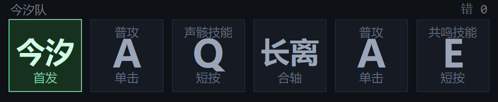
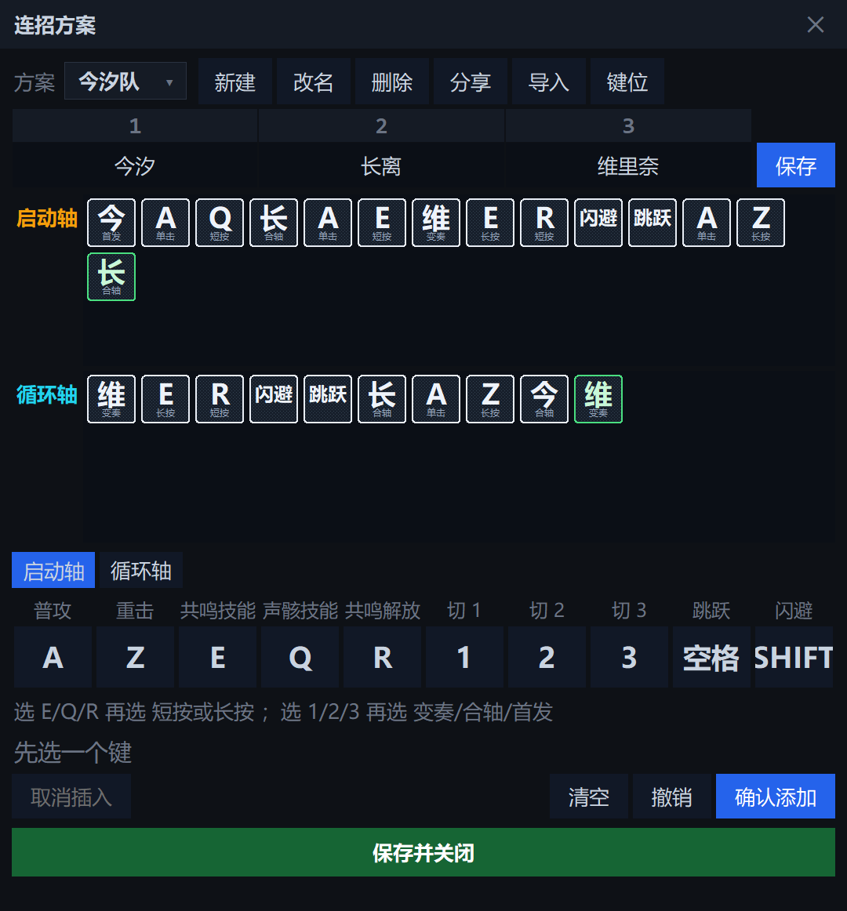

# 鸣潮连招助手（Wuthering Waves Combo Helper）

> 一个常驻桌面的连招提示器：把「接下来该按什么」摆在屏幕上，按对了才往前走，按错了立刻红闪提醒。
>
> 专为《鸣潮》的连招练习设计：普攻/重击/共鸣技能/声骸技能/共鸣解放/切人，全部支持长短按与变奏·合轴区分。



---

## 下载（免安装）

不想装 Python？直接去 [Releases](https://github.com/shanyeqianfeng/wuthering-combo-helper/releases) 下载：

```
wuthering-combo-helper-v1.0.0-win64.zip   ≈ 11 MB
```

解压后双击 `鸣潮连招助手.exe` 即可，**不需要 Python、不需要任何依赖**（内置运行时）。
数据保存在 exe 旁的 `方案` 文件夹里。

> 首次运行 Windows 可能提示「未知发布者」（未做代码签名），点「更多信息 → 仍要运行」即可。

---

## 它解决什么问题

练习输出循环时最难受的是「记得顺序但经常按错一个键」，然后整条循环就断了。

这个工具把连招拆成一条队列摆在屏幕上：

- 屏幕上永远显示**接下来 6 个动作**
- 按对 → 第一个格子绿闪 → 消失 → 后面整体前移
- 按错 → 第一个格子红闪「按错了」→ **不前进**，错误数 +1

这样你不用记顺序，只需要跟着格子按；按错了立刻知道。

---

## 功能

### 双轴连招

一套方案分两段：

- **启动轴**：开场那几步，只走一遍
- **循环轴**：启动轴走完后自动接上，**无限循环**

### 严格判定

| 输入 | 判定方式 |
|---|---|
| `A` | 单击鼠标左键（普攻） |
| `Z` | **长按**鼠标左键（重击） |
| `E` / `Q` / `R` | 共鸣技能 / 声骸技能 / 共鸣解放（区分短按、长按） |
| `1` / `2` / `3` | 切人（显示角色名，标注 变奏 / 合轴） |
| `空格` | 跳跃 |
| `闪避` / `SHIFT` | 闪避（左右 Shift 都认，不区分长短按） |

> 技能 / 跳跃 / 闪避的**物理键可以改**：编辑器 →「键位」里重新绑定。
> **键位可以是键盘，也可以是鼠标键**（左键 / 右键 / 中键 / 前进 / 后退）。
> 键位不允许重复，也不能占用切人键 `1/2/3`；重复会被拒绝并提示（左键与普攻同键时只提示不拦）。
> 点一下那一行变成「按任意键/鼠标…」，然后按下想用的键或鼠标键即可 —— 程序在低层键盘钩子里截住按键，
> **不需要开大写锁定**，也不会弹出输入法。改完编辑器里的键位速查、键盘按钮、两条轴、
> 主窗口格子会立刻同步。
> 方案文件与分享码只保存动作名（共鸣技能、跳跃、闪避……），键位存本机 `settings.json`，
> 所以别人导入你的方案时，用的是他自己设的键。

长按阈值默认 280ms，可调。判定的不是"按了什么键"，而是"键位 + 长按/短按"是否完全一致。

### 多方案管理

- 一支队伍一个方案，可新建 / 改名 / 删除
- 每个方案单独配 1/2/3 号位的角色名，切人时直接显示角色名
- 半自动录入：点按键 → 选短按/长按（或变奏/合轴/首发）→ 选轴 → 确认添加
- 两条轴各预留三排高度，常见长度的连招不用滚动就能看全



### 节点直接编辑

轴里的每个方块都能点：

```
单击节点  →  修改这个节点 / 删除这一个 / 在后面插入 / 取消
```

- **修改**：技能在 短按↔长按 之间换，切人在 变奏/合轴 之间换
- **删除**：删掉这一个，后面自动前移
- **在后面插入**：选好按键点「确认添加」就插在那个位置（预览行会显示插入点，可「取消插入」）
- 「清空」有二次确认，防误触
- 可编辑节点是白色边框，每条轴最后一个节点是绿色边框（不可点 = 后面没有可插的位置）

### 首发

`1/2/3` 除了 变奏 / 合轴，还有 **首发**——开场首发的切人。
它只允许放在**启动轴第一个节点**，放别处会被拒绝并提示。

### 方案分享

编辑器里有「分享 / 导入」，生成一串分享码：

```
WX-A7ZC-57580109E4BB8AE6B190E9989F06E4BB8AE6B19006E995BFE7A6BB09E7BBB4E9878CE5A588040101021006201112231424
```

格式与编码见下文[方案码格式](#方案码格式)。

### 窗口行为

- 无边框常驻置顶，点击穿透（不挡游戏输入）
- 「锁定」后强制置顶并穿透；解锁后可以拖动
- 半透明、支持 150% 缩放屏（DPI 感知，字不虚）

---

## 快速开始

### 环境

- Windows 10 / 11
- Python 3.10 以上（安装时勾选 **Add Python to PATH**）

### 直接运行

```bash
python combo_overlay.py
```

想要无黑框，用 `pythonw combo_overlay.py`。

启动后窗口会出现在屏幕下方居中位置，第一次启动会在同目录生成空方案。

### 打包成独立文件夹（可选）

仓库里附带了 `launcher.cs`，可以用 Windows 自带的编译器做一个 6KB 的启动器 exe：

```bash
csc /target:winexe /win32icon:assets/icon.ico /out:鸣潮连招助手.exe /r:System.Windows.Forms.dll launcher.cs
```

目录结构：

```
鸣潮连招助手\
├─ 鸣潮连招助手.exe
├─ program\combo_overlay.py
├─ 方案\teams.json
└─ README.txt
```

`launcher.cs` 会找本机 Python，并把数据目录指向 `方案\`（通过环境变量 `COMBO_DATA_DIR`）。

---

## 使用说明

### 主窗口

| 按钮 | 作用 |
|---|---|
| 方案 | 打开连招编辑器 |
| 重载 | 重新读取 `teams.json`（手改文件后用） |
| 暂停 | 暂停判定，不练时按一下，避免误计数 |
| 重来 | 进度退回启动轴开头 |
| 锁定 | 锁定位置 + 置顶 + 点击穿透；再点解锁后可拖动 |
| 退出 | 关闭程序 |

### 编辑器

1. **方案**：下拉切换，或新建 / 改名 / 删除
2. **角色名**：三格填 1/2/3 号位角色，点「保存」（变绿表示已存）
3. **启动轴 / 循环轴**：小方框显示已录入招式，多了自动换行，滚轮可翻
4. **键盘**：选 `A Z E Q R 1 2 3 空格`
   - 选 `E/Q/R` → 再选 短按 / 长按
   - 选 `1/2/3` → 再选 变奏 / 合轴
   - 选投放的轴 → 确认添加
5. **保存并关闭**：存盘并关闭编辑器

> 编辑期间判定会暂停，关掉编辑器自动恢复。

---

## 数据文件

所有数据都是纯文本 JSON，位于程序目录（打包版在 `方案\`）：

`teams.json`

```json
{
  "active": 0,
  "teams": [
    {
      "name": "今汐队",
      "names": { "1": "今汐", "2": "长离", "3": "维里奈" },
      "start": "A A Z E",
      "loop": "1变奏 E长 Q 2合轴 R 3变奏"
    }
  ]
}
```

`settings.json`：窗口位置、格子大小、长按阈值、透明度、锁定状态，以及**本机键位表** `keymap`。

每次保存前会自动把旧文件备份成 `teams.json.bak`。

### 手写连招格式

| 写法 | 含义 |
|---|---|
| `普攻` | 单击左键 |
| `重击` | 长按左键 |
| `共鸣技能` / `声骸技能` / `共鸣解放` | 三种技能短按 |
| `共鸣技能长` / `声骸技能长` / `共鸣解放长` | 三种技能长按 |
| `1变奏` `2合轴` `3变` | 切人 + 轴类型 |
| `1首发`（仅启动轴第一个） | 开场首发的切人 |
| `跳跃` | 跳跃 |
| `闪避` | 闪避 |
| `共鸣技能=战技` | 自定义显示文字（格子显示"战技"） |

> 这是方案的**唯一写法**：只写动作名，物理键位不写进方案。
> 早期版本用过 `A/Z/E/Q/R/空格/SHIFT` 这种键名写法，已经不再支持（格式从第一版起就是动作名）。

---

## 方案码格式

分享码形如 `WX-<队伍码>-<十六进制>`。

**编码**

```
二进制 = "WX" + 版本(1B)
       + [方案名][角色1][角色2][角色3]    每个 = 长度(1B) + UTF-8
       + [启动轴][循环轴]                 每个 = 招数(1B) + 每招 1B
```

**招式字节表**

| 招 | 字节 | 招 | 字节 |
|---|---|---|---|
| A 普攻 | `01` | Z 重击 | `02` |
| E 短按 | `10` | E 长按 | `11` |
| Q 短按 | `12` | Q 长按 | `13` |
| R 短按 | `14` | R 长按 | `15` |
| 1 变奏 | `20` | 1 合轴 | `21` |
| 2 变奏 | `22` | 2 合轴 | `23` |
| 3 变奏 | `24` | 3 合轴 | `25` |
| 空格 | `30` | | |

**队伍码**：`CRC32(二进制)` 取低位，映射到去掉 `I O 0 1` 的 28 字符表，共 4 位。

抄错任意一个字符，队伍码就对不上，导入会直接报错，不会静默出错。

---

## 文件结构

```
.
├─ combo_overlay.py     主程序（纯标准库：tkinter + ctypes，无第三方依赖）
├─ launcher.cs          可选：打包成 exe 用的启动器源码
├─ docs/
│   ├─ main.png         主界面截图
│   └─ editor.png       编辑器截图
├─ assets/
│   ├─ icon.ico         程序图标
│   └─ icon.png
├─ examples/
│   └─ teams.example.json
├─ README.md
├─ LICENSE
└─ .gitignore
```

---

## 常见问题

**Q：窗口点不到 / 拖不动？**
点「锁定」按钮切换。锁定状态是点击穿透（为了不挡游戏），解锁后才能拖动。

**Q：按了没反应？**
先看是否处于「暂停」或编辑器打开状态——这两种情况下不判定。

**Q：重击总是判错？**
长按阈值默认 280ms，觉得太短/太长可改 `settings.json` 的 `hold_ms`。

**Q：换了台电脑，方案怎么带走？**
复制整个 `方案` 文件夹，或者用「分享 / 导入」传方案码。

**Q：为什么不直接做按键宏？**
这个工具只做提示与判定，不代替你操作——练习时的手感还是自己的。

---

## 说明

- 本项目是个人练习工具，与《鸣潮》官方（库洛游戏）无关
- 仅读取键鼠输入用于判定，不注入、不修改游戏
- 不采集、不上传任何数据，全部逻辑本地运行

## License

[MIT](LICENSE)
